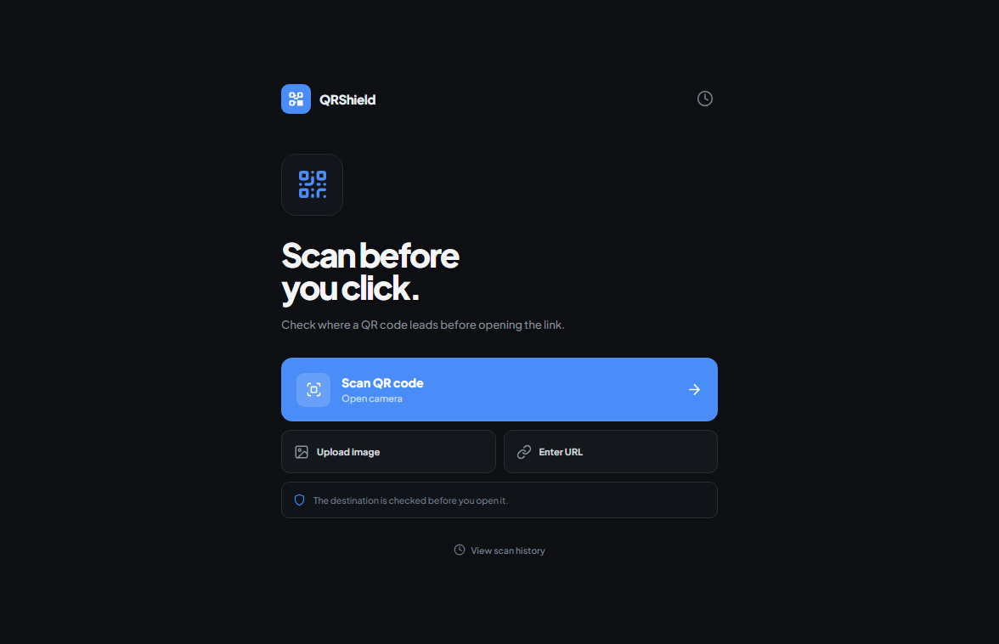
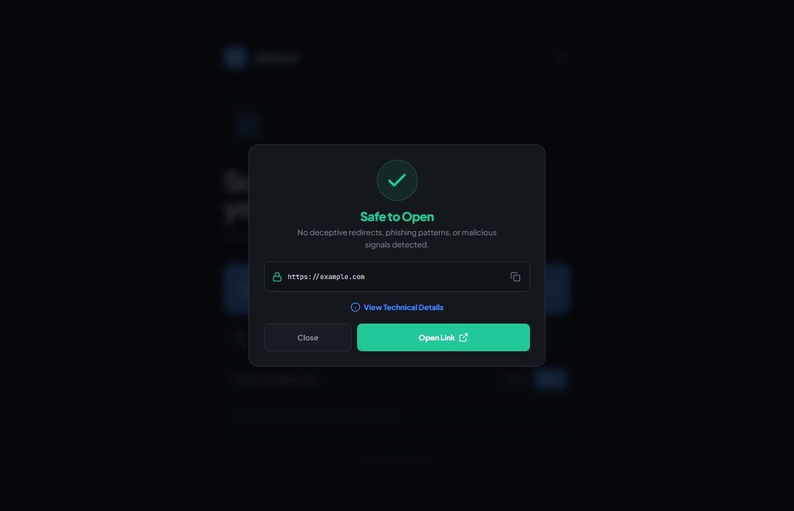
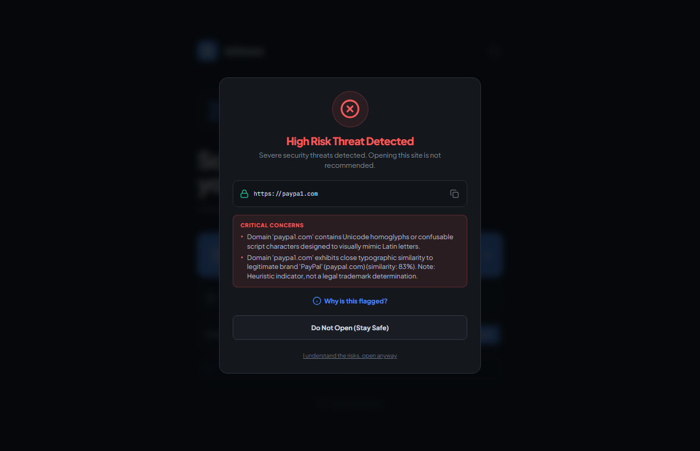

# QRShield — QR & URL Security Inspector

> **A multi-layered, explainable cybersecurity tool and web application designed to defend users against Quishing (QR Phishing), deceptive redirect chains, SSRF attacks, and lookalike domains.**

---

## 📋 Table of Contents
- [Overview](#-overview)
- [The Problem: Why Quishing is Dangerous](#-the-problem-why-quishing-is-dangerous)
- [Key Features](#-key-features)
- [Application Screenshots](#-application-screenshots)
- [The 6-Layer Security Inspection Engine](#-the-6-layer-security-inspection-engine)
- [Smart Non-URL QR Handling](#-smart-non-url-qr-handling)
- [System Architecture](#-system-architecture)
- [Technology Stack](#-technology-stack)
- [Project Directory Structure](#-project-directory-structure)
- [Installation & Setup](#-installation--setup)
- [How to Run the Application](#-how-to-run-the-application)
- [API Endpoints](#-api-endpoints)
- [Automated Testing & Verification](#-automated-testing--verification)
- [Team Members & College Submission](#-team-members--college-submission)
- [Disclaimer & Academic Notice](#-disclaimer--academic-notice)

---

## 🛡️ Overview

**QRShield** acts as an **intelligent security airlock** between physical QR codes and digital web browsers. When a user scans or uploads a QR code, QRShield inspects the destination through six deterministic security layers *before* any browser renders the page or executes potentially malicious code.

Unlike traditional scanner apps that blindly open embedded links, QRShield provides:
- **Instant Pre-Execution Analysis**: Verifies final destinations through multi-hop redirect tracking without letting the client touch harmful landing pages.
- **Explainable Verdicts**: Classifies targets as **Safe**, **Suspicious**, or **High Risk**, accompanied by clear, non-technical explanations.
- **Deep Technical Diagnostics**: On-demand visibility into the complete HTTP redirect chain, WHOIS domain registration age, detected form types, and security evidence.
- **Payment & Credential Protection**: Dedicated safety handlers for UPI payment codes, Wi-Fi configurations, and credential-harvesting phishing forms.

---

## ⚠️ The Problem: Why Quishing is Dangerous

1. **Blind Trust Execution**: Default camera apps on iOS and Android automatically prompt users to open scanned URLs with minimal domain verification.
2. **Physical Sticker Replacement**: Attackers paste fraudulent QR code stickers over legitimate ones in parking lots, dining establishments, and public payment counters.
3. **Email Gateway Evasion**: Traditional email security gateways inspect plaintext hyperlinks but frequently fail to parse QR code image attachments in phishing emails.
4. **Multi-Hop Obfuscation**: Scammers leverage legitimate URL shortening services (`bit.ly`, `tinyurl.com`) and redirect chains to mask the final destination domain.
5. **Brand Impersonation**: Typosquatting and Unicode homoglyph attacks (e.g., Cyrillic characters replacing Latin letters) fool visual inspection while masquerading as reputable financial institutions or services.

---

## ✨ Key Features

### 1. Three Input Modes
- **Live Camera Scanner**: Hardware-accelerated scanning using browser WebRTC (`getUserMedia`) with standard `BarcodeDetector` and an offline `jsQR` canvas fallback.
- **Upload Image & Clipboard Paste**: Select image files (`.png`, `.jpg`, `.jpeg`, `.webp`, `.bmp`), drag-and-drop onto the dropzone, or press **`Ctrl + V` anywhere** on the page to analyze screenshots directly from the clipboard. Features dual client-side and backend OpenCV/pyzbar decoding.
- **Direct URL Input**: Direct input for suspicious URLs with automatic URL normalization (e.g., auto-prepending `https://`).

### 2. Progressive Disclosure UI
- **Low Risk (Score 0–29)**: Clean green status badge, verified final destination, direct **"Open Link"** button, and technical details button.
- **Suspicious (Score 30–69)**: Highlights the primary concerns with an **"Open Anyway"** confirmation modal and technical inspection breakdown.
- **High Risk (Score 70+ or Critical Flag)**: Bold red alert highlighting specific threats (e.g., typosquatting, credential harvesting, SSRF attempt) advising the user not to proceed.
- **Diagnostic Drawer ("Why?")**: Comprehensive diagnostic view featuring an interactive redirect hop visualizer, scored evidence table with severity badges (`HIGH`, `MEDIUM`, `LOW`, `INFO`), and safety disclaimers.

### 3. Local Audit History
- Stores scan logs locally in an asynchronous SQLite database.
- View past scan timestamps, submitted URLs, final destinations, scores, and verdicts with one-click deletion support.

---

## 📸 Application Screenshots

Captured directly from the live running QRShield application:

### 1. Main Scanner Interface


### 2. Safe URL Analysis Result


### 3. High-Risk Phishing Threat Result


---

## 🔍 The 6-Layer Security Inspection Engine

Each scanned URL passes through six deterministic analysis modules:

```text
 Scanned URL ─► [ Layer 1: Syntax & Obfuscation Heuristics ]
                     │
             [ Layer 2: Multi-Hop Redirect Tracker + SSRF Guard ]
                     │
             [ Layer 3: Brand Typosquatting & Homoglyphs ]
                     │
             [ Layer 4: WHOIS Domain Age & High-Risk TLDs ]
                     │
             [ Layer 5: Webpage Login & Payment Form Detection ]
                     │
             [ Layer 6: Safe Browsing & Threat Intelligence ]
                     │
                     ▼
          Calibrated Risk Score (0-100) ──► Verdict & Explanations
```

1. **Layer 1: URL Structure & Obfuscation Analysis**
   - Flags plaintext `http://` connections.
   - Detects raw IP address hosts (e.g., `http://192.0.2.1/login`).
   - Identifies suspicious userinfo `@` tricks (e.g., `https://trusted.com@attacker.com`).
   - Detects excessive URL length (>256 chars), multi-layer percent-encoding, and URL shortener domains (`bit.ly`, `tinyurl.com`, `t.co`).

2. **Layer 2: Multi-Hop Redirect Tracker with SSRF Guard**
   - Follows redirect chains up to 8 hops using asynchronous HTTP requests.
   - Flags cross-domain redirects and HTTPS-to-HTTP security downgrades.
   - **SSRF (Server-Side Request Forgery) Guard**: Resolves DNS before fetching each hop. Immediately halts and flags requests pointing to RFC-1918 private ranges (`10.0.0.0/8`, `172.16.0.0/12`, `192.168.0.0/16`), loopback (`127.0.0.1`, `::1`), link-local, or cloud metadata endpoints (`169.254.169.254`).

3. **Layer 3: Brand Lookalike & Homoglyph Detection**
   - Calculates Levenshtein edit distance (`rapidfuzz`) against a curated database of 60+ top financial, tech, and e-commerce brands.
   - Detects internationalized domain names (IDNs) using confusable Unicode homoglyphs (e.g., Cyrillic `а` vs Latin `a`).

4. **Layer 4: Domain Age (WHOIS) & TLD Abuse Heuristics**
   - Queries WHOIS registration records to flag throwaway domains registered less than 30 days ago.
   - Evaluates high-risk, disposable top-level domains frequently abused in spam campaigns (e.g., `.xyz`, `.top`, `.click`, `.fit`).

5. **Layer 5: Webpage & Form Security Inspection**
   - Inspects the landing page HTML structure safely without executing untrusted JavaScript.
   - Identifies credential harvesting password fields (`<input type="password">`) and payment card inputs.
   - Flags cross-domain form actions (e.g., a page hosted on Domain A secretly posting credentials to Domain B).

6. **Layer 6: Threat Intelligence & Safe Browsing**
   - Interfaces with Google Safe Browsing API (when configured) to query known malware and social engineering databases.

---

## 💳 Smart Non-URL QR Handling

QRShield automatically detects and securely parses non-hyperlink QR formats without opening external browser windows:

| QR Type | Format Pattern | Information Displayed | Safe Action Available |
| :--- | :--- | :--- | :--- |
| **UPI Payment** | `upi://pay?...` | Payee Name, UPI ID (VPA), Amount, Transaction Note | **Copy Details** (prevents fraudulent web redirects) |
| **Wi-Fi Network** | `WIFI:T:...;S:...;P:...` | Network SSID, Security Type (WPA/WPA2), Password | **Copy Password** to connect manually |
| **Contact (vCard)** | `BEGIN:VCARD` | Contact Name, Phone Number, Email, Organization | **Copy Details** |
| **Plain Text** | Raw string data | Formatted readable text block | **Copy Text** |

---

## 🏗️ System Architecture

```text
┌────────────────────────────────────────────────────────────────────────┐
│                        QRShield Web Frontend                           │
│     (Responsive HTML5 • Vanilla CSS3 • Vanilla ES6 JavaScript)         │
│                                                                        │
│   [ Live Camera ]          [ Image Drop / Ctrl+V ]    [ Direct URL ]   │
│   (WebRTC Stream)          (Native File API)          (Input Field)    │
│   (BarcodeDetector/jsQR)   (Client & Server Fallback)                  │
└───────────────────────────────────┬────────────────────────────────────┘
                                    │ HTTP Fetch / Multipart Form
                                    ▼
┌────────────────────────────────────────────────────────────────────────┐
│                        FastAPI Backend Engine                          │
│                                                                        │
│  ┌───────────────────────┐   ┌───────────────────────────────────────┐ │
│  │ Static File Server    │   │ API Endpoints                         │ │
│  │ (Serves Frontend App) │   │  • POST /api/v1/scan                  │ │
│  └───────────────────────┘   │  • POST /api/v1/scan/decode-image     │ │
│                              │  • GET  /api/v1/history               │ │
│                              │  • DELETE /api/v1/history/{id}        │ │
│                              │  • GET  /api/v1/health                │ │
│                              └───────────────────┬───────────────────┘ │
│                                                  │                     │
│  ┌───────────────────────────────────────────────▼───────────────────┐ │
│  │                 6-Layer Security Inspection Engine                │ │
│  │                                                                   │ │
│  │  1. URL Syntax & Obfuscation Heuristics                           │ │
│  │  2. Redirect Chain Tracker + SSRF Guard (Up to 8 hops)            │ │
│  │  3. Brand Lookalike & Homoglyph Typosquatting Engine              │ │
│  │  4. Domain Age (WHOIS) & TLD Abuse Heuristics                     │ │
│  │  5. Webpage Inspection (Login & Payment form analysis)            │ │
│  │  6. Threat Intelligence & Safe Browsing Feeds                     │ │
│  └───────────────────────────────────────────────┬───────────────────┘ │
│                                                  │                     │
│                              ┌───────────────────▼───────────────────┐ │
│                              │ SQLite Database (Async via SQLAlchemy)│ │
│                              │ Persists scan history & findings      │ │
│                              └───────────────────────────────────────┘ │
└────────────────────────────────────────────────────────────────────────┘
```

---

## 💻 Technology Stack

### Frontend
- **Markup & Styling**: Pure semantic HTML5, Vanilla CSS3 with custom variables, modern dark cybersecurity theme, and responsive flex/grid layouts.
- **Client Logic**: Vanilla ES6 JavaScript (zero Node.js/npm dependencies, zero bundling step, sub-50ms load time).
- **Client QR Decoding**: Hardware-accelerated `BarcodeDetector` API with bundled offline `jsQR` canvas fallback.

### Backend
- **Web Framework**: [FastAPI](https://fastapi.tiangolo.com/) (Python 3.10+) with [Uvicorn](https://www.uvicorn.org/) ASGI server.
- **Data Validation & Settings**: [Pydantic v2](https://docs.pydantic.dev/) and `pydantic-settings`.
- **Database ORM**: [SQLAlchemy 2.0](https://www.sqlalchemy.org/) with asynchronous SQLite driver ([aiosqlite](https://aiosqlite.omnilib.dev/)).
- **HTTP Client**: [HTTPX](https://www.python-httpx.org/) (asynchronous HTTP client for multi-hop redirect resolution).
- **HTML Parsing**: [BeautifulSoup4](https://www.crummy.com/software/BeautifulSoup/) (DOM analysis for credential/payment forms).
- **Cybersecurity & Heuristics**:
  - `tldextract` (robust Public Suffix List domain parsing)
  - `rapidfuzz` (Levenshtein distance calculation for typosquatting)
  - `confusable_homoglyphs` (Unicode script homoglyph detection)
  - `python-whois` (domain registration age querying)
  - `opencv-python-headless` & `pyzbar` (multi-pass backend image enhancement and QR decoding)
  - `pyyaml` (configurable risk weightings and thresholds)

### Testing & Verification
- `pytest` & `pytest-asyncio` (asynchronous unit and integration testing)
- `respx` (mocking external HTTP requests and redirect chains)

---

## 📁 Project Directory Structure

```text
QRShield/
│
├── run_website.bat                    # Windows 1-click launcher
├── run_website.py                     # Python launcher (starts server & opens browser)
├── QRSHIELD_MASTER_GUIDE.md           # In-depth architectural & algorithm specification
├── README.md                          # Project documentation
├── .gitignore                         # Git exclusion rules
│
├── docs/                              # Project documentation assets
│   └── screenshots/                   # Application screenshots
│       ├── scanner_view.png           # Main scanner interface
│       ├── verdict_safe.png           # Safe verdict modal
│       └── verdict_suspicious.png     # High-risk threat alert modal
│
├── frontend/                          # Clean, zero-dependency web frontend
│   ├── index.html                     # Responsive UI layout & modal templates
│   ├── css/
│   │   └── style.css                  # Modern cybersecurity dark theme
│   └── js/
│       ├── app.js                     # WebRTC camera, file upload, Ctrl+V, UI logic
│       └── jsqr.min.js                # Bundled offline client-side QR decoder
│
└── backend/                           # FastAPI Security Engine
    ├── requirements.txt               # Python package dependencies
    ├── .env.example                   # Environment configuration template
    │
    ├── app/
    │   ├── main.py                    # App entry point, mounts frontend/ & API
    │   ├── config.py                  # Timeouts, limits, and feature settings
    │   ├── logging_config.py          # Structured logging configuration
    │   │
    │   ├── analysis/                  # Core security analysis modules
    │   │   ├── qr_decoder.py          # OpenCV + pyzbar multi-pass QR image decoder
    │   │   ├── url_analyzer.py        # URL syntax, obfuscation, and shortener checks
    │   │   ├── redirect_tracker.py    # Multi-hop redirect follower with SSRF guard
    │   │   ├── domain_analyzer.py     # Domain age (WHOIS) & TLD risk heuristics
    │   │   ├── lookalike_detector.py  # Levenshtein typosquatting & Unicode homoglyphs
    │   │   ├── webpage_analyzer.py    # Form detection (login/payment/cross-domain)
    │   │   ├── brand_context.py       # Brand context mismatch engine
    │   │   ├── reputation_client.py   # Optional Google Safe Browsing client
    │   │   └── risk_engine.py         # Evidence scoring, thresholds & verdict engine
    │   │
    │   ├── api/                       # REST API route handlers
    │   │   ├── routes_scan.py         # POST /api/v1/scan, POST /scan/decode-image
    │   │   ├── routes_history.py      # GET /api/v1/history, DELETE /history/{id}
    │   │   └── routes_health.py       # GET /api/v1/health
    │   │
    │   ├── schemas/                   # Pydantic request & response models
    │   │   ├── scan.py                # ScanRequest, ScanResponse, ImageDecodeResponse
    │   │   └── common.py              # Finding, RedirectHop, VerdictEnum
    │   │
    │   ├── security/                  # Backend security guards
    │   │   ├── ssrf_guard.py          # DNS & RFC-1918 private/loopback IP validation
    │   │   └── rate_limiter.py        # Per-IP sliding-window rate limiter
    │   │
    │   ├── data/                      # Database & data assets
    │   │   ├── db.py                  # SQLAlchemy async engine & session maker
    │   │   ├── models.py              # ScanRecord, FindingRecord, RedirectHopRecord
    │   │   └── brand_list.json        # 60+ targeted brand domains for typosquatting
    │   │
    │   └── config/
    │       └── risk_weights.yaml      # Calibrated risk weights and thresholds
    │
    ├── tests/                         # Automated test suite (38 tests)
    │   ├── conftest.py                # Shared fixtures and mock setup
    │   ├── integration/
    │   │   └── test_scan_api.py       # End-to-end API integration tests
    │   └── unit/
    │       ├── test_url_analyzer.py
    │       ├── test_redirect_tracker.py
    │       ├── test_risk_engine.py
    │       ├── test_ssrf_guard.py
    │       ├── test_lookalike_detector.py
    │       └── test_webpage_analyzer.py
    │
    └── scripts/
        └── verify_live_e2e.py         # End-to-end live verification script
```

---

## ⚙️ Installation & Setup

### Prerequisites
- **Python**: Version 3.10 or higher installed ([Download Python](https://www.python.org/downloads/))
- **Operating System**: Windows, macOS, or Linux
- **Web Browser**: Any modern browser (Google Chrome, Microsoft Edge, Mozilla Firefox, Safari)

### Step 1: Clone the Repository
```bash
git clone https://github.com/tanushreeburde/QRShield.git
cd QRShield
```

### Step 2: Create a Python Virtual Environment
Open a terminal in the project root directory:

```powershell
# Windows (PowerShell / Command Prompt)
python -m venv backend\venv

# macOS / Linux
python3 -m venv backend/venv
```

### Step 3: Install Required Dependencies
```powershell
# Windows (PowerShell)
.\backend\venv\Scripts\python.exe -m pip install -r backend\requirements.txt

# Windows (Command Prompt)
backend\venv\Scripts\python.exe -m pip install -r backend\requirements.txt

# macOS / Linux
./backend/venv/bin/pip install -r backend/requirements.txt
```

### Step 4: Configure Environment Variables
Copy the template configuration file:

```powershell
# Windows (PowerShell)
Copy-Item backend\.env.example backend\.env

# Windows (Command Prompt)
copy backend\.env.example backend\.env

# macOS / Linux
cp backend/.env.example backend/.env
```

*(Optional)* If you have a Google Safe Browsing API key, you can add it to `backend/.env` under `SAFE_BROWSING_API_KEY=`. If left empty, all offline and heuristic layers continue to function completely.

---

## 🚀 How to Run the Application

### Option A: One-Click Quick Launch (Windows)
Double-click the **`run_website.bat`** file located in the project root directory.

This script automatically:
1. Detects `backend\venv\Scripts\python.exe` (or falls back to system Python).
2. Runs `run_website.py`.
3. Automatically opens `http://127.0.0.1:8000` in your default web browser.

---

### Option B: Terminal Command (Cross-Platform)
From the project root directory:

```powershell
# Windows (PowerShell)
.\backend\venv\Scripts\python run_website.py

# Windows (Command Prompt)
backend\venv\Scripts\python run_website.py

# macOS / Linux
./backend/venv/bin/python run_website.py
```

---

### Option C: Direct Uvicorn Launch
From the `backend/` directory:

```powershell
# Windows (PowerShell)
cd backend
.\venv\Scripts\python -m uvicorn app.main:app --host 127.0.0.1 --port 8000 --reload

# macOS / Linux
cd backend
./venv/bin/python -m uvicorn app.main:app --host 127.0.0.1 --port 8000 --reload
```

---

### 🌐 Accessing the Application
- **Web Interface**: Open [http://127.0.0.1:8000](http://127.0.0.1:8000)
- **Interactive API Documentation (Swagger UI)**: Open [http://127.0.0.1:8000/docs](http://127.0.0.1:8000/docs)
- **Alternative API Documentation (ReDoc)**: Open [http://127.0.0.1:8000/redoc](http://127.0.0.1:8000/redoc)
- **Health Check Endpoint**: [http://127.0.0.1:8000/api/v1/health](http://127.0.0.1:8000/api/v1/health)

---

## 📡 API Endpoints

| Method | Endpoint | Description |
| :--- | :--- | :--- |
| `POST` | `/api/v1/scan` | Submits a URL for full 6-layer security inspection. |
| `POST` | `/api/v1/scan/decode-image` | Uploads an image file to decode embedded QR codes using OpenCV and pyzbar. |
| `GET` | `/api/v1/history` | Retrieves recent scan history from the local SQLite database. |
| `DELETE` | `/api/v1/history/{scan_id}` | Deletes a specific scan record and its associated findings from history. |
| `GET` | `/api/v1/health` | Returns the operational health status of backend security services. |

---

## 🧪 Automated Testing & Verification

QRShield includes an automated test suite comprising **38 unit and integration tests** validating each layer of the security engine:

### Running the Test Suite
From the project root:

```powershell
# Windows (PowerShell)
.\backend\venv\Scripts\python.exe -m pytest -v

# Windows (Command Prompt)
backend\venv\Scripts\python.exe -m pytest -v

# macOS / Linux
./backend/venv/bin/pytest -v
```

### Verified Test Results
```text
============================= test session starts =============================
platform win32 -- Python 3.13.2, pytest-9.1.1, pluggy-1.6.0
rootdir: D:\RBU\RBU Sem 5\BEH\Final Project\BEH PROJECT\BEH PROJECT
collected 38 items

backend/tests/integration/test_scan_api.py (9 tests) ........... PASSED
backend/tests/unit/test_lookalike_detector.py (4 tests) ........ PASSED
backend/tests/unit/test_redirect_tracker.py (3 tests) .......... PASSED
backend/tests/unit/test_risk_engine.py (4 tests) ............... PASSED
backend/tests/unit/test_ssrf_guard.py (7 tests) ................ PASSED
backend/tests/unit/test_url_analyzer.py (8 tests) .............. PASSED
backend/tests/unit/test_webpage_analyzer.py (3 tests) .......... PASSED

======================= 38 passed, 2 warnings in 17.68s =======================
```
*(Note: The 2 warnings are upstream Starlette test deprecation notices regarding `HTTP_422_UNPROCESSABLE_ENTITY` and do not affect functionality).*

---

### Running Live End-to-End Verification
To execute live scans against real scenarios (safe sites, SSRF loopback protections, typosquatting domains, and history recording):

```powershell
# Windows
cd backend
.\venv\Scripts\python.exe scripts\verify_live_e2e.py

# macOS / Linux
cd backend
./venv/bin/python scripts/verify_live_e2e.py
```

---

## 👥 Team Members & College Submission

**Course / Subject**: BEH Project (B.Tech Computer Science & Engineering- Cybersecurity)  
**Academic Semester**: Semester 5  
**Section**: D1  
**Institution**: Ramdeobaba University (RBU)  
**Project Title**: QRShield — Explainable QR & URL Security Inspector for Quishing Mitigation  

### Team Details

<<<<<<< HEAD
| Sr. No. | Student Name | Roll Number | Role / Contribution |
| :---: | :--- | :--- | :--- |
| 1 | *Tanushree Burde* | *Roll No 2* | Frontend Architecture, UI/UX & WebRTC Camera Scanner |
| 2 | *Nidhi Bhayani* | *Roll No 3* | Security Engine, SSRF Guard & Redirect Tracker |
| 3 | *Shivansh Gupta* | *Roll No 5* | Heuristics (WHOIS, Lookalike, Forms) & Test Suite |
| 4 | *Shreyansh Dewangan* | *Roll No 24* | Database Persistence, API Routing & Documentation |

=======
| Sr. No. | Student Name | Roll Number |
| :---: | :--- | :--- |
| 1 | Tanushree Burde | D1-02 |
| 2 | Nidhi Bhayani | D1-03 |
| 3 | Shivansh Gupta | D1-05 |
| 4 | Shreyansh Dewangan | D1-24 |
>>>>>>> 415b3ae (docs: finalize README with screenshots, team details, and verified test results)

---

## 📄 Disclaimer & Academic Notice

### Academic Notice
QRShield was developed as an academic project for the BEH curriculum at Ramdeobaba University. No open-source license is currently provided.

### Security Disclaimer
QRShield is an educational and defensive cybersecurity project developed for academic evaluation. While it leverages deterministic heuristics, domain age verification, and redirect inspection, automated phishing detection is not guaranteed to identify every malicious URL. Users should exercise caution when opening unverified links.
